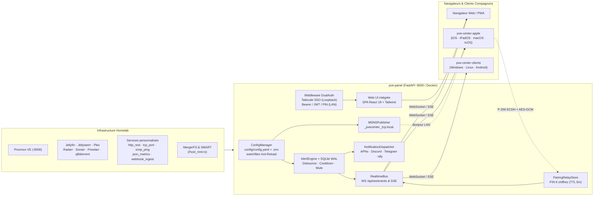

<div align="center">

[English](README.md) | [Français](README.fr.md)

  
  <h1>PVE Command Center (<code>pve-panel</code>)</h1>
  <p>
    <strong>Cockpit temps réel pour Proxmox VE, stockage SMART/MergerFS, services homelab et alertes multi-canaux.</strong><br />
    Backend FastAPI déclaratif &nbsp;•&nbsp; Interface Web React 19 Liquid Glass intégrée &nbsp;•&nbsp; Docker &amp; Installateur Proxmox LXC
  </p>

  <p>
    
    
    
    
    
    <a href="LICENSE"></a>
  </p>

  <p>
    <a href="#-fonctionnalités">Fonctionnalités</a> &nbsp;·&nbsp;
    <a href="#-architecture">Architecture</a> &nbsp;·&nbsp;
    <a href="#-installation-rapide">Installation rapide</a> &nbsp;·&nbsp;
    <a href="#-dépôts-compagnons">Écosystème</a> &nbsp;·&nbsp;
    <a href="#-documentation">Documentation</a> &nbsp;·&nbsp;
    <a href="#%EF%B8%8F-feuille-de-route">Feuille de route</a>
  </p>
</div>

---

## ✨ Fonctionnalités

- **Supervision Proxmox VE & Contrôle d'alimentation** : métriques temps réel du nœud (CPU, RAM, swap, rootfs, pools de stockage) et actions sur LXC/VM QEMU (`start`, `stop`, `reboot`, `shutdown`) via un token API restreint (`PanelRole`) avec garde-fou anti-auto-arrêt (`panel_self_vmid`).
- **Stockage MergerFS & Santé SMART** : fusionne les statistiques `statvfs` des montages `/host_mnt` avec les informations SMART physiques Proxmox (`model`, `serial`, `wwn`, `health`).
- **Intégrations Homelab, Opérations Live & Utilisateurs unifiés** :
  - Widgets temps réel pour **Jellyfin**, **Plex**, **Radarr**, **Sonarr**, **Prowlarr** et **qBittorrent**.
  - Centre d'opérations interactif : historique des tâches Proxmox, approbation/refus des demandes **Jellyseerr**, pause/reprise et mode Tortue **qBittorrent**, plus déclenchement de scans de bibliothèques Jellyfin/Plex.
  - Gestion et synchronisation unifiées des comptes entre **Jellyfin** et **Jellyseerr** avec protection du compte propriétaire (`protected_owner_username`).
- **Configuration déclarative `config.yaml` & Hot-Reload** :
  - Schéma YAML validé par Pydantic v2 (`config/config.yaml`) avec interpolation `${VAR_NAME}` / `${VAR_NAME:-default}`, masquage des secrets (`********`), écriture atomique (compatible *bind-mount* `EBUSY` Docker), repli automatique `.env` + `services.yaml`, et rechargement à chaud `watchfiles` diffusé via WebSocket et SSE.
- **Modèle de sécurité DualAuth** :
  - **Loopback (`127.0.0.1` / `::1`)** : Tailscale Serve SSO (`Tailscale-User-Login` vérifié contre `security.allowed_tailscale_users`), jeton Bearer, ou mode dev local explicite (`DEV_AUTH_BYPASS=true`).
  - **LAN / Distant / WS / SSE** : jetons API Bearer hachés SHA-256 en temps constant (`pve_...`), code PIN Admin `PBKDF2-HMAC-SHA256` (`PUT /api/auth/pin`), `POST /api/auth/login` limité en fréquence émettant des JWT HS256, et verrouillage automatique de l'onboarding initial une fois configuré.
- **Moteur d'alertes SQLite & Notifications multi-canaux** :
  - Cinq connecteurs de supervision extensibles : `http_rest`, `tcp_port`, `icmp_ping`, `json_metrics` (extraction par chemin pointé/indexé), et `webhook_ingest` (heartbeats entrants avec TTL).
  - Persistance SQLite WAL (`state.db`) pour les états de service, l'historique des incidents, le *debouncing* (`consecutive_failures`), le *cooldown* anti-spam, la reprise automatique `DOWN -> UP`, l'acquittement et les fenêtres de mise en sourdine (`Mute`).
  - Diffusion vers **Discord** (Rich Embeds), **Telegram** (MarkdownV2), **Webhooks génériques** (ntfy, Gotify, Home Assistant) et **Apple Push Notification service (APNs HTTP/2 `.p8`)**.
- **Découverte Zéro-Config & Relais d'appairage chiffré** :
  - Publication Bonjour `_pvecenter._tcp.local.` via `AsyncZeroconf`, scan LAN borné (`_http._tcp`, `_ssh._tcp`, `_smb._tcp`), métadonnées QR `pvecenter://connect?...`, et relais éphémère à code **PIN à 6 chiffres** (`P-256 ECDH` + `AES-256-GCM`) pour l'Apple TV.
- **Interface Web PWA Liquid Glass intégrée (React 19 + Vite)** :
  - Servie directement par FastAPI avec en-têtes HTML `no-store`, thèmes adaptatifs Système / Clair / Sombre, 6 palettes d'accentuation style Cider (`cyan`, `cider`, `indigo`, `emerald`, `amber`, `purple`), 28 icônes SVG de services homelab dédiées, éditeur YAML en direct, assistants Setup & Onboarding en 4 étapes, et Mode Démo complet.

---

## 🏗️ Architecture



---

## ⚡ Installation rapide

### Option 1 — Installateur automatisé (`install.sh`)

```bash
git clone https://github.com/PVE-Center/pve-panel.git
cd pve-panel
chmod +x install.sh
sudo ./install.sh
```

`install.sh` détecte automatiquement votre environnement :
- **Mode A (Hôte Proxmox VE via `pveversion`)** : crée un conteneur LXC Debian 12 non privilégié (`nesting=1,keyctl=1`), configure `PanelRole` et `root@pam!pve-panel`, monte `/mnt` en lecture seule sur `/host_mnt`, génère `SESSION_SECRET`, initialise `.env` et `config/config.yaml`, puis déploie Docker et Tailscale Serve.
- **Mode B (Serveur Linux ou LXC existant)** : installe Docker Engine / Compose et Tailscale si nécessaires, prépare `./config:/app/config:rw` (`0700`), démarre le conteneur et configure `tailscale serve --bg http://127.0.0.1:8000`.

Options disponibles : `--in-container`, `--ts-hostname <nom>`, `--allowed-users <emails>`, `--pve-node <noeud>`.

### Option 2 — Docker Compose (manuel)

```bash
git clone https://github.com/PVE-Center/pve-panel.git
cd pve-panel
mkdir -p config
cp config/config.example.yaml config/config.yaml
cp .env.example .env
cp services.example.yaml services.yaml
docker compose up -d --build
```

Ouvrez ensuite l'interface Web (`https://<votre-machine>.ts.net` ou `http://127.0.0.1:8000` avec `DEV_AUTH_BYPASS=true` en dev) : tant que `is_configured` vaut `false`, l'**assistant d'onboarding en 4 étapes** vous guide pour configurer Proxmox VE, les utilisateurs Tailscale, le PIN Admin et votre premier jeton API Bearer.

---

## 📱 Aperçu de l'écosystème

Les clients natifs compagnons se connectent directement à `pve-panel` via Tailscale HTTPS, Bonjour LAN (`_pvecenter._tcp.local.`) ou QR Code (`pvecenter://connect`) :

<table>
  <tr>
    <td align="center" width="33%">
      <br />
      <sub><strong>Onboarding 4 étapes</strong><br />Bonjour, QR Code, Token &amp; Quick-Add</sub>
    </td>
    <td align="center" width="33%">
      <br />
      <sub><strong>Vue Poste — Mode Clair</strong><br />Liquid Glass, Alertes &amp; Baie Proxmox</sub>
    </td>
    <td align="center" width="33%">
      <br />
      <sub><strong>Vue Poste — Mode Sombre</strong><br />Télémétrie live &amp; Services personnalisés</sub>
    </td>
  </tr>
</table>

<div align="center">
  <br />
  <sub><strong>Apple TV 4K</strong> — Bannières d'alertes WebSocket en direct et appairage PIN chiffré via <code>/api/pairing/*</code>.</sub>
</div>

---

## 🌐 Dépôts compagnons

L'écosystème PVE Command Center est structuré en quatre dépôts dédiés sous l'organisation [`PVE-Center`](https://github.com/PVE-Center) :

| Dépôt | Rôle | Technologies |
|---|---|---|
| **[`pve-panel`](https://github.com/PVE-Center/pve-panel)** *(ce dépôt)* | Serveur central, API REST/WS/SSE, AlertEngine, Web UI intégrée, Docker & `install.sh` | Python 3.12, FastAPI, SQLite WAL, React 19, Vite, Tailwind |
| **[`pve-center-apple`](https://github.com/PVE-Center/pve-center-apple)** | Application Apple native pour iPhone, iPad, Mac et Apple TV | Swift 6, SwiftUI, SwiftData, CryptoKit, Network.framework |
| **[`pve-center-clients`](https://github.com/PVE-Center/pve-center-clients)** | Clients multiplateformes Windows, Linux et Android | Tauri v2 (Rust), Capacitor 8 (Android), React 19 |
| **[`pve-center-website`](https://github.com/PVE-Center/pve-center-website)** | Site vitrine, hub de téléchargement et portail de documentation bilingue | VitePress, CSS Liquid Glass / Cider |

---

## 📚 Documentation

### Guides et références (Français / English)

| Sujet | Français | English |
|---|---|---|
| **Architecture & Sécurité** | [docs/fr/architecture.md](docs/fr/architecture.md) | [docs/en/architecture.md](docs/en/architecture.md) |
| **Installation & Déploiement** | [docs/fr/installation.md](docs/fr/installation.md) | [docs/en/installation.md](docs/en/installation.md) |
| **Référence de configuration** | [docs/fr/configuration-reference.md](docs/fr/configuration-reference.md) | [docs/en/configuration-reference.md](docs/en/configuration-reference.md) |
| **Référence API (REST / WS / SSE)** | [docs/fr/api-reference.md](docs/fr/api-reference.md) | [docs/en/api-reference.md](docs/en/api-reference.md) |

### Développement local & Tests

```bash
# Installation backend & exécution des tests
python3.12 -m venv .venv
source .venv/bin/activate
pip install -r backend/requirements.txt ruff
ruff check backend
pytest -v

# Compilation frontend
cd frontend
npm ci
npx tsc --noEmit
npm run build
```

---

## 🗺️ Feuille de route

- [x] Schéma déclaratif `config/config.yaml` avec interpolation `${VAR}` et rechargement à chaud `watchfiles`
- [x] Middleware DualAuth ASGI (Tailscale Serve SSO + jetons Bearer SHA-256 + PIN Admin PBKDF2 + JWT)
- [x] 5 connecteurs de supervision extensibles (`http_rest`, `tcp_port`, `icmp_ping`, `json_metrics`, `webhook_ingest`)
- [x] `AlertEngine` SQLite WAL + notifications Discord, Telegram, Webhooks génériques/ntfy et APNs HTTP/2
- [x] Relais d'appairage chiffré par PIN à 6 chiffres (`P-256 ECDH` + `AES-256-GCM`) et découverte Bonjour/mDNS
- [ ] Agrégation multi-nœuds Proxmox VE (sélecteur de nœuds et bascule cluster)
- [ ] Export `/metrics` Prometheus et télémétrie OpenTelemetry optionnelle
- [ ] Application granulaire des rôles (`operator` vs `viewer` vs `admin`) sur les routes d'écriture

---

## 📄 Licence

Distribué sous licence [MIT](LICENSE). Consultez [CONTRIBUTING.md](CONTRIBUTING.md) et [SECURITY.md](SECURITY.md) pour contribuer ou signaler une faille de sécurité.
