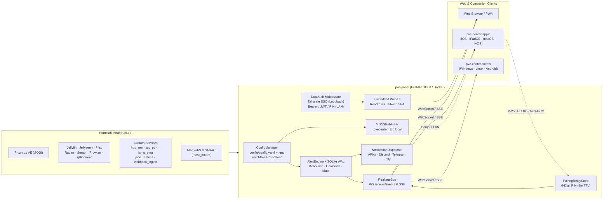

<div align="center">

[English](README.md) | [Français](README.fr.md)

  
  <h1>PVE Command Center (<code>pve-panel</code>)</h1>
  <p>
    <strong>Real-time Proxmox VE cockpit, SMART/MergerFS storage monitor, homelab operations hub, and multi-channel alerting server.</strong><br />
    Declarative FastAPI Backend &nbsp;•&nbsp; Embedded Liquid Glass React 19 Web UI &nbsp;•&nbsp; Docker &amp; Proxmox LXC Installer
  </p>

  <p>
    
    
    
    
    
    <a href="LICENSE"></a>
  </p>

  <p>
    <a href="#-features">Features</a> &nbsp;·&nbsp;
    <a href="#-architecture">Architecture</a> &nbsp;·&nbsp;
    <a href="#-quick-install">Quick Install</a> &nbsp;·&nbsp;
    <a href="#-companion-repositories">Ecosystem Repos</a> &nbsp;·&nbsp;
    <a href="#-documentation">Documentation</a> &nbsp;·&nbsp;
    <a href="#%EF%B8%8F-roadmap">Roadmap</a>
  </p>
</div>

---

## ✨ Features

- **Proxmox VE Supervision & Power Control**: Real-time node CPU, RAM, swap, rootfs, storage pools, and LXC/QEMU VM controls (`start`, `stop`, `reboot`, `shutdown`) powered by a restricted API token (`PanelRole`) with a built-in self-shutdown safeguard (`panel_self_vmid`).
- **MergerFS & SMART Disk Monitoring**: Combines `statvfs` capacity telemetry on `/host_mnt` mounts with Proxmox physical disk SMART metadata (`model`, `serial`, `wwn`, `health`).
- **Homelab Integrations, Live Ops & Unified Users**:
  - Live metric widgets for **Jellyfin**, **Plex**, **Radarr**, **Sonarr**, **Prowlarr**, and **qBittorrent**.
  - Interactive Operations center: Proxmox task history, **Jellyseerr** request approval/decline, **qBittorrent** torrent pause/resume and Turtle Speed Mode, plus Jellyfin/Plex library refresh triggers.
  - Unified user provisioning and synchronization between **Jellyfin** and **Jellyseerr** with protected owner enforcement (`protected_owner_username`).
- **Declarative `config.yaml` & Hot-Reload**:
  - Pydantic v2 validated YAML configuration (`config/config.yaml`) with `${VAR_NAME}` / `${VAR_NAME:-default}` environment interpolation, secret masking (`********`), atomic writes (`EBUSY`-safe for Docker bind mounts), automatic `.env` + `services.yaml` fallback, and live `watchfiles` hot-reload broadcast over WebSocket and SSE.
- **DualAuth Security Model**:
  - **Loopback (`127.0.0.1` / `::1`)**: Tailscale Serve SSO (`Tailscale-User-Login` validated against `security.allowed_tailscale_users`), Bearer tokens, or optional local dev bypass (`DEV_AUTH_BYPASS=true`).
  - **LAN / Remote / WS / SSE**: Constant-time SHA-256 hashed Bearer API tokens (`pve_...`), `PBKDF2-HMAC-SHA256` Admin PIN (`PUT /api/auth/pin`), rate-limited `POST /api/auth/login` issuing HS256 JWT sessions, and automatic onboarding lockdown once configured.
- **Stateful AlertEngine & Multi-Channel Notifications**:
  - Five extensible monitoring connectors: `http_rest`, `tcp_port`, `icmp_ping`, `json_metrics` (dotted/bracket path extraction), and `webhook_ingest` (push heartbeats with TTL).
  - SQLite WAL persistence (`state.db`) for service states, incident history, debouncing (`consecutive_failures`), anti-spam `cooldown_seconds`, `DOWN -> UP` auto-recovery, incident acknowledgment, and per-service `Mute` windows.
  - Built-in dispatchers for **Discord** (Rich Embeds), **Telegram** (MarkdownV2), **Generic Webhooks** (ntfy, Gotify, Home Assistant), and **Apple Push Notification service (APNs HTTP/2 `.p8`)**.
- **Zero-Config Discovery & Encrypted Pairing Relay**:
  - Publishes `_pvecenter._tcp.local.` via `AsyncZeroconf`, runs bounded LAN mDNS scans (`_http._tcp`, `_ssh._tcp`, `_smb._tcp`), generates `pvecenter://connect?...` QR metadata, and relays ephemeral 6-digit PIN `P-256 ECDH` + `AES-256-GCM` pairing bundles for Apple TV.
- **Embedded Liquid Glass Web UI (React 19 + Vite)**:
  - Served directly by FastAPI with `no-store` HTML headers, adaptive System / Light / Dark modes, 6 Cider-inspired accent presets (`cyan`, `cider`, `indigo`, `emerald`, `amber`, `purple`), 28 custom SVG homelab brand icons, live YAML editor, 4-step Onboarding & Setup modals, and full Demo Mode.

---

## 🏗️ Architecture



---

## ⚡ Quick Install

### Option 1 — Automated Installer (`install.sh`)

```bash
git clone https://github.com/PVE-Center/pve-panel.git
cd pve-panel
chmod +x install.sh
sudo ./install.sh
```

`install.sh` automatically detects your environment:
- **Mode A (Proxmox VE Host via `pveversion`)**: Provisions an unprivileged Debian 12 LXC container (`nesting=1,keyctl=1`), creates `PanelRole` and `root@pam!pve-panel`, mounts `/mnt` read-only at `/host_mnt`, generates `SESSION_SECRET`, initializes `.env` and `config/config.yaml`, and starts Docker + Tailscale Serve.
- **Mode B (Existing Linux Host or LXC)**: Installs Docker Engine / Compose and Tailscale if absent, prepares `./config:/app/config:rw` (`0700`), starts the container, and configures `tailscale serve --bg http://127.0.0.1:8000`.

Useful flags: `--in-container`, `--ts-hostname <name>`, `--allowed-users <emails>`, `--pve-node <node>`.

### Option 2 — Docker Compose (Manual)

```bash
git clone https://github.com/PVE-Center/pve-panel.git
cd pve-panel
mkdir -p config
cp config/config.example.yaml config/config.yaml
cp .env.example .env
cp services.example.yaml services.yaml
docker compose up -d --build
```

Open the Web UI (`https://<your-tailnet-host>.ts.net` or `http://127.0.0.1:8000` with `DEV_AUTH_BYPASS=true` in dev): when `is_configured` is `false`, the 4-step **Onboarding Wizard** lets you configure Proxmox VE, Tailscale users, an Admin PIN, and your first Bearer API token.

---

## 📱 Ecosystem Preview

Companion native clients connect directly to `pve-panel` over Tailscale HTTPS, LAN Bonjour (`_pvecenter._tcp.local.`), or QR deep link (`pvecenter://connect`):

<table>
  <tr>
    <td align="center" width="33%">
      <br />
      <sub><strong>4-Step Onboarding</strong><br />Bonjour, QR Scan, Token &amp; Quick-Add</sub>
    </td>
    <td align="center" width="33%">
      <br />
      <sub><strong>Overview — Light Mode</strong><br />Liquid Glass, Alerts &amp; Proxmox Bay</sub>
    </td>
    <td align="center" width="33%">
      <br />
      <sub><strong>Overview — Dark Mode</strong><br />Live Telemetry &amp; Custom Services</sub>
    </td>
  </tr>
</table>

<div align="center">
  <br />
  <sub><strong>Apple TV 4K</strong> — Real-time WebSocket alert banners and encrypted 6-digit PIN pairing via <code>/api/pairing/*</code>.</sub>
</div>

---

## 🌐 Companion Repositories

The PVE Command Center ecosystem is organized into four dedicated repositories under [`PVE-Center`](https://github.com/PVE-Center):

| Repository | Purpose | Stack |
|---|---|---|
| **[`pve-panel`](https://github.com/PVE-Center/pve-panel)** *(this repo)* | Core server, REST/WS/SSE API, AlertEngine, embedded Web UI, Docker & `install.sh` | Python 3.12, FastAPI, SQLite WAL, React 19, Vite, Tailwind |
| **[`pve-center-apple`](https://github.com/PVE-Center/pve-center-apple)** | Native Apple application for iPhone, iPad, Mac, and Apple TV | Swift 6, SwiftUI, SwiftData, CryptoKit, Network.framework |
| **[`pve-center-clients`](https://github.com/PVE-Center/pve-center-clients)** | Desktop & mobile apps for Windows, Linux, and Android | Tauri v2 (Rust), Capacitor 8 (Android), React 19 |
| **[`pve-center-website`](https://github.com/PVE-Center/pve-center-website)** | Project landing page, platform downloads & full bilingual docs portal | VitePress, Liquid Glass / Cider CSS |

---

## 📚 Documentation

### Guides & References (English / Français)

| Topic | English | Français |
|---|---|---|
| **Architecture & Security** | [docs/en/architecture.md](docs/en/architecture.md) | [docs/fr/architecture.md](docs/fr/architecture.md) |
| **Installation & Deployment** | [docs/en/installation.md](docs/en/installation.md) | [docs/fr/installation.md](docs/fr/installation.md) |
| **Configuration Reference** | [docs/en/configuration-reference.md](docs/en/configuration-reference.md) | [docs/fr/configuration-reference.md](docs/fr/configuration-reference.md) |
| **API Reference (REST / WS / SSE)** | [docs/en/api-reference.md](docs/en/api-reference.md) | [docs/fr/api-reference.md](docs/fr/api-reference.md) |

### Local Development & Testing

```bash
# Backend setup & tests
python3.12 -m venv .venv
source .venv/bin/activate
pip install -r backend/requirements.txt ruff
ruff check backend
pytest -v

# Frontend build
cd frontend
npm ci
npx tsc --noEmit
npm run build
```

---

## 🗺️ Roadmap

- [x] Declarative `config/config.yaml` schema with `${VAR}` interpolation & `watchfiles` hot-reload
- [x] DualAuth ASGI middleware (Tailscale Serve SSO + SHA-256 Bearer tokens + PBKDF2 Admin PIN + JWT)
- [x] 5-protocol extensible connectors (`http_rest`, `tcp_port`, `icmp_ping`, `json_metrics`, `webhook_ingest`)
- [x] SQLite WAL `AlertEngine` + Discord, Telegram, Generic/ntfy, and APNs HTTP/2 dispatchers
- [x] Encrypted 6-digit PIN pairing relay (`P-256 ECDH` + `AES-256-GCM`) and Bonjour/mDNS discovery
- [ ] Multi-node Proxmox VE cluster aggregation (`nodes/*` selector & failover views)
- [ ] Prometheus `/metrics` endpoint & OpenTelemetry export option
- [ ] Role-based scoping enforcement (`operator` vs `viewer` vs `admin`) across write routes

---

## 📄 License

Distributed under the [MIT License](LICENSE). See [CONTRIBUTING.md](CONTRIBUTING.md) and [SECURITY.md](SECURITY.md) for contribution and vulnerability disclosure guidelines.
